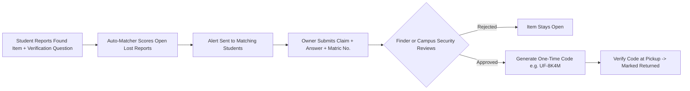

# UniFind - University Lost & Found Platform

[](https://uni-find-lost-and-found.vercel.app)
[](https://github.com/DanMadinah/UniFind-Lost-and-Found/actions/workflows/ci.yml)
[](https://www.typescriptlang.org/)
[](https://react.dev/)
[](https://firebase.google.com/)
[](./LICENSE)

**Live Deployment:** https://uni-find-lost-and-found.vercel.app  
**Author:** Muhammad Abdullahi Bukar

---

## Overview

Every semester on campus, students misplace AirPods, matric cards, hostel keys, calculators, and water bottles. Most reports end up scattered across dozens of WhatsApp groups and get buried within hours.

**UniFind** is a central campus Lost & Found web application built for students and Campus Security staff. It combines an interactive campus map, weighted Lost-to-Found matching, ownership verification questions, and one-time pickup handover codes so belongings return to the right owner quickly and safely.

---

## Core Features

| Feature | How It Works |
| :--- | :--- |
| **Interactive Campus Radar Map** | Click any of the 8 campus zones (Main Library, Engineering & IT, Central Lecture Halls, Student Cafeteria, Campus Surau, Hostel Complex, Sports Complex, Bus Hub) to view live Lost/Found counts and filter items visually. |
| **Weighted Match Scoring** | Automatically compares open Lost reports against open Found reports (`0-100%`) using category match (35 pts), exact or neighboring campus zone (25 / 12 pts), keyword overlap (up to 30 pts), and date proximity (up to 10 pts). |
| **Ownership Verification** | Finders attach a hidden verification question when posting a Found item. Claimants submit their answer and matric number; only the finder or Campus Security can approve or reject claims. |
| **One-Time Handover Code** | Approving a claim generates a unique 6-character pickup code (e.g. `UF-8K4M`). At physical pickup, entering the code verifies the claimant and marks the item **Returned**. |
| **Privacy by Default** | Reporter contact details and matric numbers stay hidden on public cards and are revealed only to Campus Security or to an approved claimant. |
| **Validated Photo Uploads** | Uploaded photos are checked for image MIME type and size (max 2 MB), then resized and compressed on an HTML5 `<canvas>` before saving. |
| **Security Desk Tools** | Campus Security accounts can review any claim across campus and export formula-safe CSV logs protected against spreadsheet injection. |
| **Light & Dark Mode** | Full light/dark theme toggle saved per browser, responsive across desktop and mobile. |

---

## End-to-End Verification Flow



---

## Security & Privacy Architecture

- **Real Authentication (Production):** Uses Firebase Authentication (Email/Password) via the Identity Toolkit REST API. Every new registration defaults to the `STUDENT` role.
- **Backend-Enforced Roles:** Staff roles (`SECURITY`) are stored at `/unifind/roles/<uid>` and enforced server-side through [docs/FIREBASE_RULES.json](docs/FIREBASE_RULES.json), not just in React state.
- **Per-Item Cloud Sync:** Writes go to individual records (`/unifind/items/<id>.json`) rather than overwriting the full list, with real-time updates streamed over `EventSource` (SSE).
- **CSV Formula Injection Protection:** All exported cells are quoted and prefixed if they start with `=`, `+`, `-`, `@`, tab, or carriage return.

---

## Two Operating Modes

> **Note:** Real Firebase Authentication and live cloud sync are enabled only when `VITE_FIREBASE_DB_URL` and `VITE_FIREBASE_API_KEY` are configured in your environment. On the live Vercel deployment linked above, both are configured and active.

### 1. Live Production Mode (Firebase Auth + Realtime Database)
Copy `.env.example` to `.env` and add your Firebase project credentials:

```bash
VITE_FIREBASE_DB_URL=https://<your-project>-default-rtdb.asia-southeast1.firebasedatabase.app
VITE_FIREBASE_API_KEY=<your-firebase-web-api-key>
```

Then in Firebase Console:
1. Enable **Email/Password** under **Authentication -> Sign-in method**.
2. Create a **Realtime Database** and publish the rules from [docs/FIREBASE_RULES.json](docs/FIREBASE_RULES.json).
3. To grant Campus Security access to a staff account, add `/unifind/roles/<USER_UID>` = `"SECURITY"` in Realtime Database -> Data.

### 2. Local Demo Mode (No `.env` Required)
If the Firebase environment variables are left blank, UniFind runs in local browser storage (`localStorage`) for quick offline testing:
- **Student demo login:** Enter any name, email, and matric number.
- **Campus Security demo login:** Use prototype code `sec123`.

---

## Project Structure

```text
university-lost-and-found/
├── .github/workflows/ci.yml      # GitHub Actions CI (Vitest + TypeScript + Vite build)
├── docs/FIREBASE_RULES.json      # Backend Firebase Realtime Database security rules
├── src/
│   ├── components/
│   │   ├── CampusMap.tsx         # Interactive SVG campus radar map with live zone pins
│   │   ├── ClaimModal.tsx        # Claim submission, review, and handover code verification
│   │   ├── ItemCard.tsx          # Privacy-aware Lost/Found pinboard card
│   │   ├── LoginScreen.tsx       # Split-screen auth screen (Firebase Auth + Demo fallback)
│   │   └── ReportModal.tsx       # Lost/Found form with validated canvas photo compression
│   ├── data/
│   │   ├── firebaseAuth.ts       # Firebase Identity Toolkit auth & role lookup
│   │   ├── matcher.ts            # Weighted Lost-to-Found match scoring engine
│   │   └── store.ts              # Item state helpers, per-item RTDB sync, SSE & CSV export
│   ├── App.tsx                   # Sidebar navigation rail, filters, alerts & main workspace
│   └── types.ts                  # Shared TypeScript interfaces
└── tests/
    ├── matcher.test.ts           # Unit tests for weighted match scoring
    └── store.test.ts             # Unit tests for claim approval, handover codes & CSV safety
```

---

## Getting Started Locally

### Prerequisites
- Node.js 18+ and npm

### Commands

```bash
# 1. Clone the repository
git clone https://github.com/DanMadinah/UniFind-Lost-and-Found.git
cd UniFind-Lost-and-Found

# 2. Install dependencies
npm install

# 3. Run unit tests (Vitest)
npm test

# 4. Start the local dev server
npm run dev

# 5. Typecheck and build for production
npm run build
```

---

## License

This project is licensed under the MIT License - see the [LICENSE](./LICENSE) file for details.
